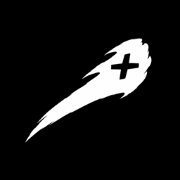
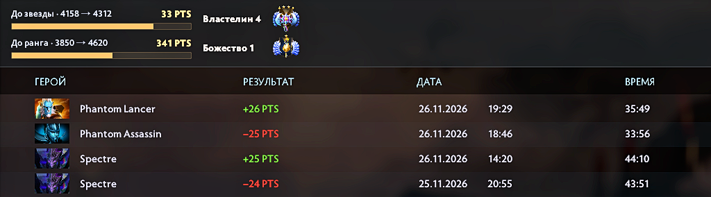
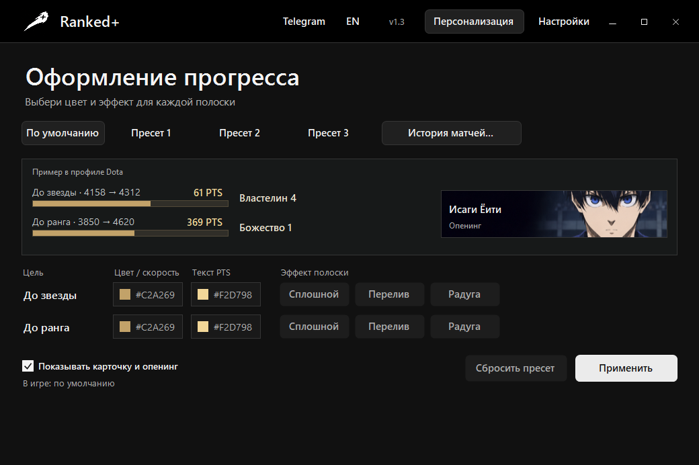
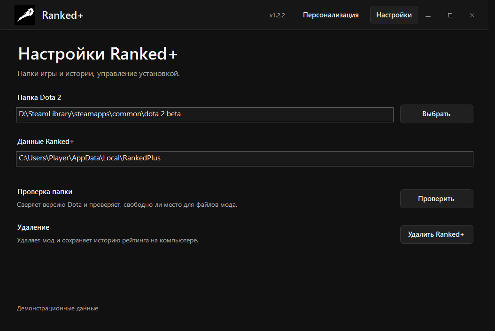

#  Ranked+ Launcher для Dota 2

Ranked+ добавляет изменение MMR прямо в обычную историю матчей. В профиле видно, сколько очков осталось до следующей звезды и медали.

Ranked+ полностью бесплатный.

**Могут ли забанить?** Ranked+ меняет интерфейс профиля и показывает данные рейтинга, не вмешиваясь в матч. Гарантии от Valve для сторонних модов нет. [Правила VAC](https://help.steampowered.com/en/faqs/view/571A-97DA-70E9-FF74)

## Установка

1. Скачай `RankedPlus-Launcher.exe` из последнего [релиза](../../releases/latest).
2. Закрой Dota 2 и запусти установщик. Он найдёт папку игры через Steam. Другую папку можно указать в **Настройках**.
3. Отметь **Записывать PTS при запуске Dota**, если хочешь отслеживать новые матчи, и нажми **Установить**. Лаунчер сам настроит журнал для твоего аккаунта Steam. Если он попросит выйти из Steam, сделай это через меню и оставь лаунчер открытым до сообщения **«Отслеживание включено»**.
4. Запусти Dota из Steam как обычно. Перед первой рейтинговой игрой открой свою историю матчей для стартового замера. После игры дай рейтингу обновиться и открой историю снова.

В лаунчере Канеки нарисован чёрной тушью в духе печатной манги. Карточки листаются по кругу, стрелками можно выбрать нужный образ. Живой фон включён по умолчанию. Двигай мышью в любом месте окна на главной, чтобы Канеки и крыша смещались в разных направлениях. Эффект можно выключить кнопкой в баннере. [Посмотреть короткое демо](docs/images/live-background.mp4)

## Что означают цифры в истории

- `+25 PTS` или `−25 PTS` — изменение удалось связать с конкретным матчем.
- `≈ +25 PTS` — изменение MMR известно, а привязка к матчу вероятна.
- «Победа» или «Поражение» — для этой игры пока нет достаточно данных. Особенно это относится к матчам, сыгранным до установки.

## Обновления и настройки

Ярлык **Ranked+ Launcher** открывает установки и настройки. Лаунчер проверяет релизы на GitHub при открытии и устанавливает подходящее обновление после закрытия Dota. Резервная копия прежней версии и твоя история сохраняются.

Нажми **Ranked+** в левом верхнем углу, чтобы вернуться на главную. Номер сборки лаунчера виден рядом с вкладками.

Кнопка **EN** переключает лаунчер на английский, **RU** возвращает русский. Полоски и их сообщения в игре используют язык клиента Dota. Кнопка **Telegram** открывает [канал автора Ranked+](https://t.me/getheartzxc).

## Персонализация полосок

Открой **Персонализация**, выбери один из трёх пресетов и настрой полоски до звезды и до ранга. Для каждой можно выбрать цвет заполнения, цвет текста PTS и эффект. Изменения сразу видны на примере профиля. Нажми **Применить**, чтобы сохранить пресет и использовать его при следующем запуске Dota. **По умолчанию** возвращает стандартное оформление, а **Сбросить пресет** возвращает исходные цвета выбранного слота.

При выборе **Радуга** вместо цвета заполнения появится скорость цикла. Нажимай на неё, чтобы выбрать 4, 8 или 16 секунд. Цвет текста PTS задаётся отдельно.

У каждого ранга своя карточка Канеки из *Tokyo Ghoul*. По нажатию на неё открывается опенинг. Чтобы скрыть карточку из профиля Dota, сними галочку **Показывать карточку Канеки и опенинг**, нажми **Применить** и перезапусти игру. Полоски прогресса останутся на месте.

Кнопка **Проверить** в настройках сверяет версию Dota и проверяет, есть ли конфликт с другими модами. Там же можно удалить Ranked+ и сохранить свою историю MMR.

Если отслеживание включено, небольшая программа Windows ждёт запуска Dota. Она включает Companion на время игры и останавливает его после выхода. Отслеживание можно выключить в лаунчере. История MMR хранится на этом компьютере. Для установки, обновлений и отслеживания отдельный вход в Steam или GitHub не нужен.

Поддерживаемую сборку Dota указываем в каждом релизе. Если Steam уже обновил игру, дождись совместимой сборки Ranked+.
