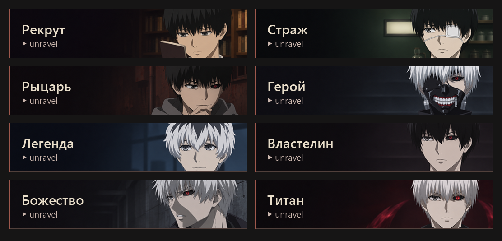
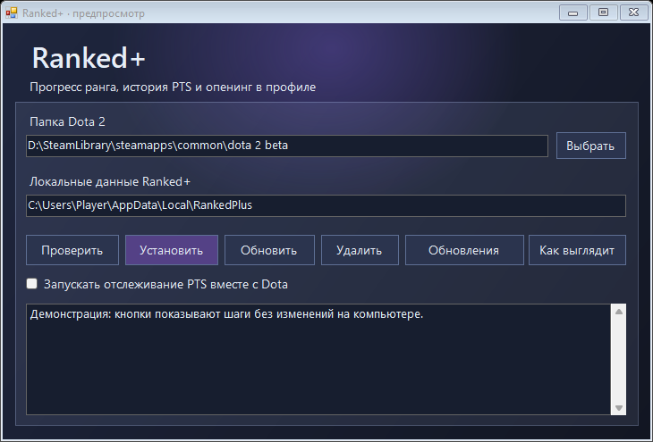

# Ranked+ для Dota 2

Ranked+ добавляет изменение MMR прямо в обычную историю матчей. В профиле видно, сколько очков осталось до следующей звезды и медали. Рядом с прогрессом живёт небольшая отсылка к *Tokyo Ghoul*: у каждого из восьми рангов своя карточка Канеки, а по нажатию открывается опенинг.

## Установка

1. Скачай `RankedPlus-Setup.exe` из последнего [релиза](../../releases).
2. Закрой Dota 2, запусти установщик и нажми **Установить**. Он найдёт папку игры через Steam. Если Steam-библиотек несколько, путь можно выбрать вручную.
3. Для записи новых PTS включи **Запускать отслеживание PTS вместе с Dota**. В Steam открой **Dota 2 → Свойства → Общие → Параметры запуска** и допиши `-condebug` через пробел к своим текущим параметрам.
4. Запусти Dota из Steam как обычно. Перед первой рейтинговой игрой открой свою историю матчей для стартового замера. После игры дай рейтингу обновиться и открой историю снова.

## Что означают цифры в истории

- `+25 PTS` или `−25 PTS` — изменение удалось связать с конкретным матчем.
- `≈ +25 PTS` — изменение MMR известно, а привязка к матчу вероятна.
- «Победа» или «Поражение» — для этой игры пока нет достаточно данных. Особенно это относится к матчам, сыгранным до установки.

## Обновления и настройки

Ярлык **Ranked+ Launcher** открывает установки и настройки. Лаунчер проверяет релизы на GitHub при открытии и устанавливает подходящее обновление после закрытия Dota. Резервная копия прежней версии и твоя история сохраняются.

Если отслеживание включено, небольшая программа Windows ждёт запуска Dota. Она включает Companion на время игры и останавливает его после выхода. Настройку можно выключить в лаунчере. История MMR хранится на этом компьютере. Для установки, обновлений и отслеживания отдельный вход в Steam или GitHub не нужен.

Поддерживаемую сборку Dota указываем в каждом релизе. Если Steam уже обновил игру, дождись совместимой сборки Ranked+.
